# 🤖 PAMI 2025 — Petit Actionneur Mobile Indépendant

  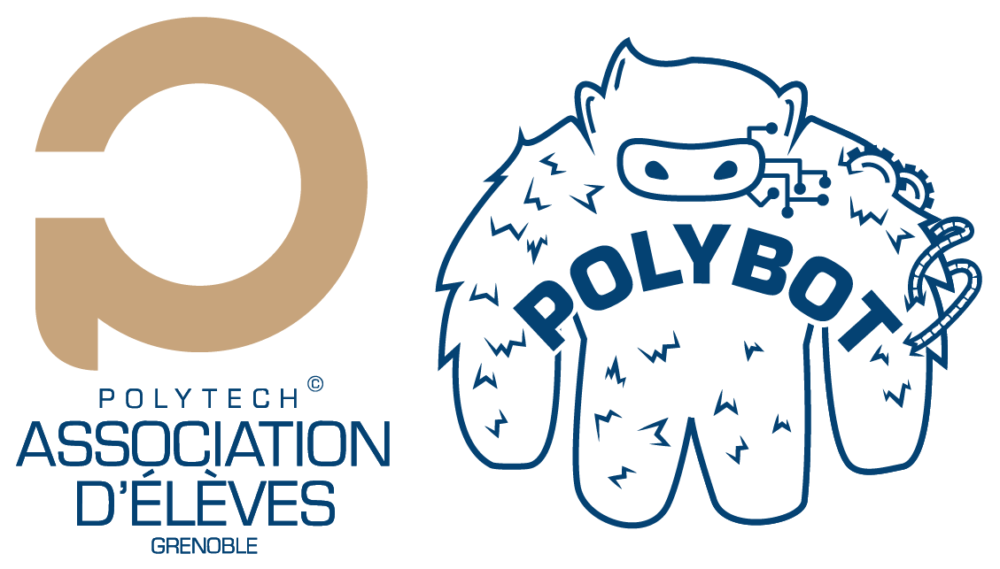
  &nbsp;&nbsp;&nbsp;&nbsp;
  

  <b>Robots autonomes conçus pour la Coupe de France de Robotique 2025 (Association Polybot - Polytech Grenoble)</b>

  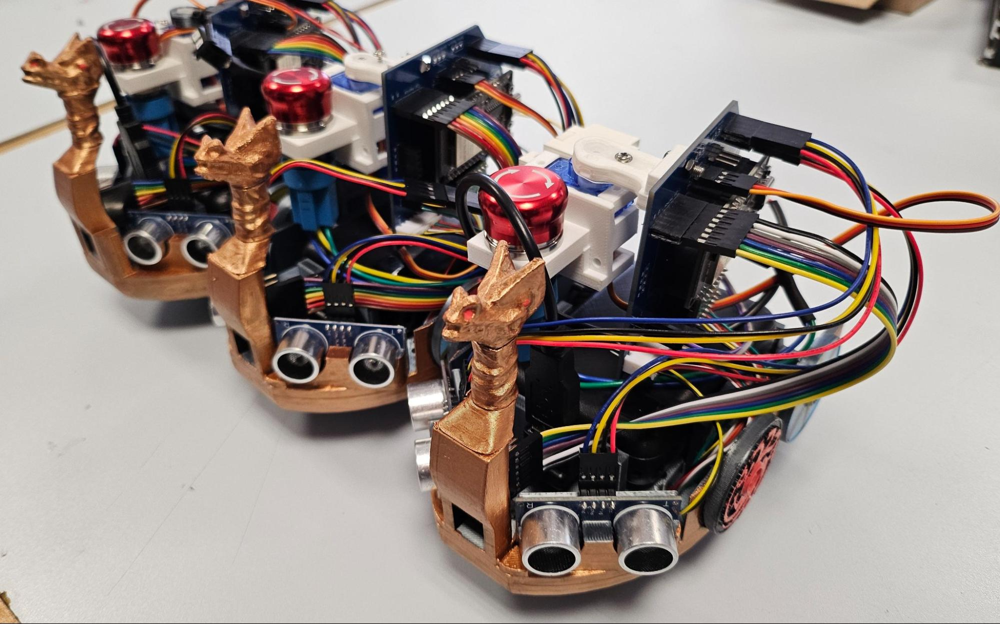

---

## 📌 Sommaire

1. [Présentation et Contexte](#-1-présentation-et-contexte)
   * [Introduction](#11-introduction)
   * [Contexte général et retour d'expérience](#12-contexte-général-et-retour-dexpérience)
   * [Tâches attendues en match](#13-tâches-attendues-en-match)
2. [Spécifications et Architecture Matérielle](#-2-spécifications-et-architecture-matérielle)
   * [Objectifs techniques](#21-objectifs-techniques)
   * [Cahier des charges et choix matériels](#22-cahier-des-charges-et-choix-matériels)
   * [Budget matériel](#23-budget-matériel)
   * [Protocole de test opérationnel](#24-protocole-de-test-opérationnel)
   * [Architecture des sous-systèmes](#25-architecture-des-sous-systèmes)
3. [Conception et Réalisation Technique](#-3-conception-et-réalisation-technique)
   * [Conception et modélisation 3D](#31-conception-et-modélisation-3d-des-pami)
   * [Conception du PCB](#32-le-pcb-printed-circuit-board)
   * [Asservissement en vitesse](#33-lasservissement-en-vitesse)
   * [Asservissement en position et Odométrie](#34-lasservissement-en-position)
   * [Détection d'obstacles (ToF & Ultrasons)](#35-la-détection-dobstacles)
   * [Algorithme d'évitement d'obstacles](#36-lévitement-dobstacles)
   * [Actionneur de fin de match](#37-lactionneur-de-fin-de-match)
4. [Livrables et Ressources](#-4-livrables-et-ressources)
5. [Perspectives d'amélioration et Conclusion](#-5-perspectives-damélioration-et-conclusion)
6. [Glossaire](#-glossaire)

---

## 📖 1. Présentation et Contexte

### 1.1. Introduction

Le projet **Petit Actionneur Mobile Indépendant (PAMI)** a pour but de participer à la Coupe de France de Robotique 2025 avec l'association Polybot. Les matchs se déroulent pendant 100 secondes, durant lesquelles les robots principaux ainsi que les robots annexes doivent réaliser un certain nombre d'actions pour marquer des points. Dans ce contexte, les PAMI sont des robots annexes au robot principal, et leurs actions s'effectuent de façon totalement autonome durant les 15 dernières secondes du match (départ à la $85^{\text{e}}$ seconde).

### 1.2. Contexte général et retour d'expérience

Cette année, deux types de PAMI différents sont utilisés lors d'un match : un unique PAMI "Star" dont le but est d'atteindre la scène, et trois PAMI "Groupies" qui doivent atteindre différentes zones au pied de la scène. Ce dépôt présente la conception complète des **PAMI "Groupies"**.

Les PAMI doivent rejoindre des zones difficiles d'accès en raison de la présence des PAMI adverses, des robots principaux en mouvement vers leurs zones de fin de match et d'éventuels éléments de jeu (boîtes de conserve) sur le terrain. Un système de navigation précis et d'évitement d'obstacles est donc indispensable.

#### Analyse du PAMI préexistant (Édition précédente)

La conception a été entièrement revue cette année pour corriger les défauts identifiés sur la génération précédente :

* **Moteurs insuffisamment fiables :** L'utilisation de servomoteurs à rotation continue engendrait une erreur de vitesse d'environ $10\%$, créant une dérive de position incompatible avec des stratégies complexes ou de l'évitement d'obstacles.
* **Connectiques instables :** Le câblage par fils *jumper* (Figure 1) entraînait des déconnexions lors des chocs ou vibrations.
* **Angle de détection trop faible :** L'utilisation de 3 capteurs ToF unidirectionnels (Figure 2) laissait d'importants angles morts latéraux (Figure 3).
* **Solidité mécanique :** Les fixations moteurs manquaient de rigidité face aux vibrations dynamiques.

Certains éléments fiables ont toutefois été conservés : la tirette de démarrage, le bouton d'arrêt d'urgence, le servomoteur d'actionneur et la roue folle.

  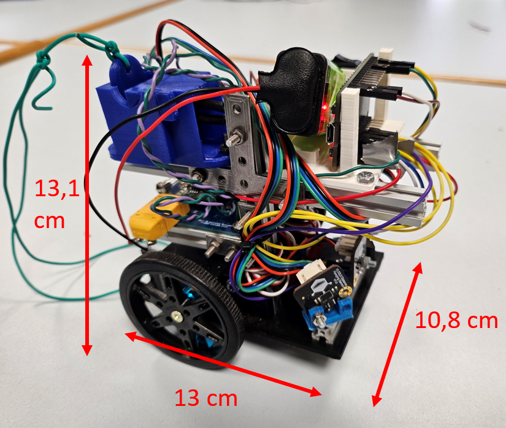 
  <em>Figure 1 : PAMI préexistant</em>

  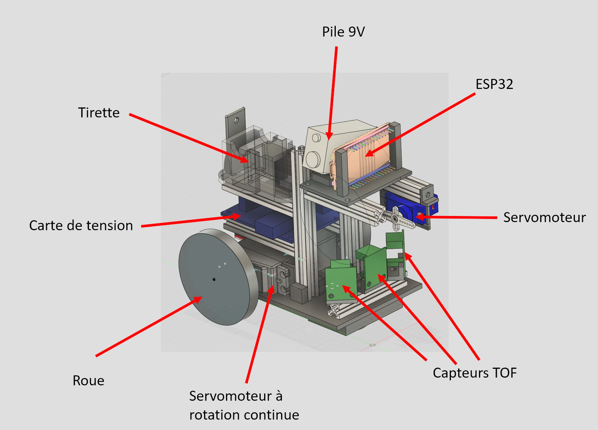 
  <em>Figure 2 : Modélisation 3D du PAMI préexistant</em>

  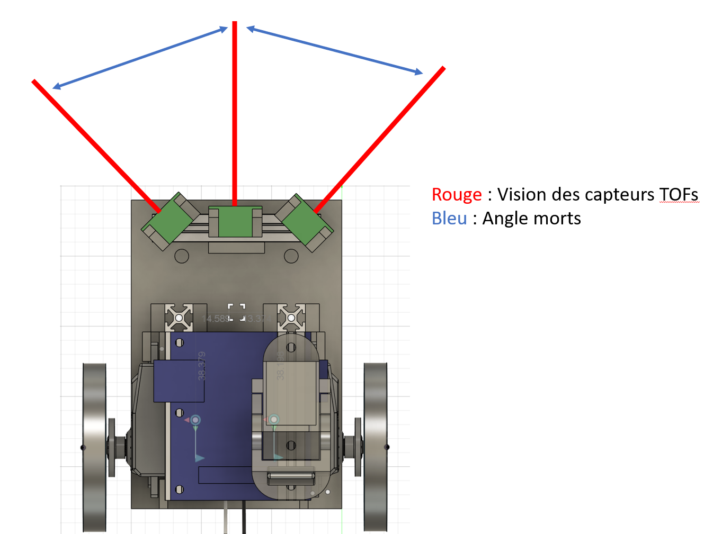 
  <em>Figure 3 : Vue en coupe du PAMI préexistant avec l'angle de vision des capteurs</em>

### 1.3. Tâches attendues en match

Lors d'un match, la tâche principale d'un PAMI est de partir de la zone de départ (numérotée 4 en vert sur la Figure 4) à la $85^{\text{e}}$ seconde pour atteindre sa zone cible (numérotée 9 en rouge) avant la $100^{\text{e}}$ seconde.

  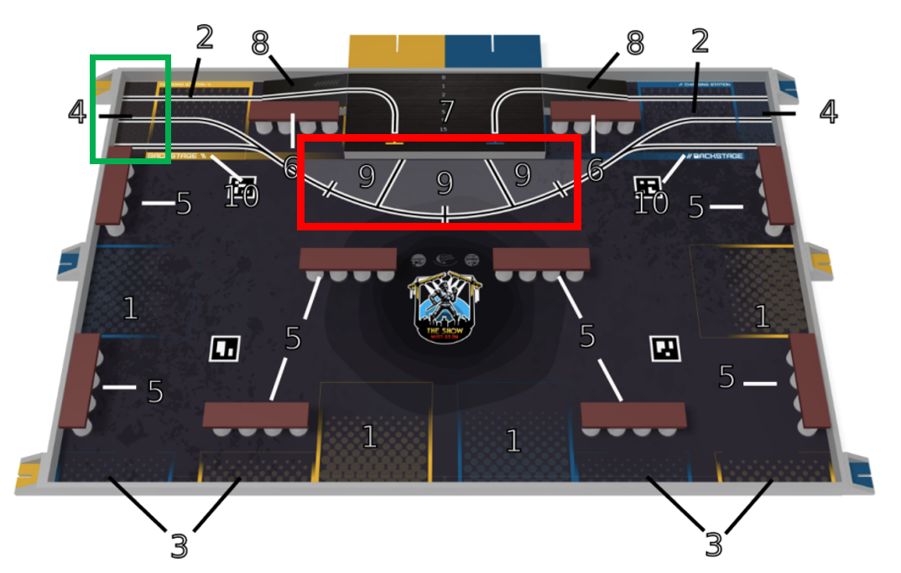 
  <em>Figure 4 : Vue du terrain de haut, zone 9 en rouge et zone 4 en vert</em>

Le second objectif réglementaire consiste à activer un **actionneur de fin de match** après les 100 secondes, qui doit effectuer un mouvement visible pour simuler une ambiance festive et rapporter des points bonus.

---

## ⚙️ 2. Spécifications et Architecture Matérielle

### 2.1. Objectifs techniques

* **Modélisation et assemblage :** Création de 3 PAMI respectant les dimensions maximales imposées par le règlement ($15\text{ cm}$ de long par $11\text{ cm}$ de large par robot).
* **Navigation autonome :** Développement d'un système de coordonnées avec odométrie, asservissement PID des moteurs et contournement intelligent d'obstacles (ToF matriciel + ultrasons).
* **Conception d'un PCB sur mesure :** Centralisation des connexions entre l'ESP32, les capteurs, le driver moteur et les actionneurs pour éliminer les faux contacts et réduire l'encombrement.
* **Actionneur de fin de match :** Intégration mécanique et logicielle d'un actionneur animé après les 100 secondes de match.

### 2.2. Cahier des charges et choix matériels

| Composant / Critère | Solution retenue |
| :--- | :--- |
| **Dimensions** | $15 \times 11\text{ cm}$ |
| **Microcontrôleur** | ESP32-DevKitC |
| **Batterie** | Batterie externe USB $10000\text{ mAh}$ ($5\text{ V}$ constant) |
| **Moteurs** | Motoréducteurs miniatures DFRobot avec encodeur (`FIT0482`) Motoréducteurs HP 100:1 (`5165`) |
| **Driver Moteurs** | Double pont en H `DRV8833` ($2 \times 1,2\text{ A}$) |
| **Base mobile** | Châssis imprimé en 3D (PLA) |
| **Roues** | Roues de $43\text{ mm}$ (`FIT0494`) |
| **Capteur ToF multizone (8x8)** | STMicroelectronics `VL53L5CX` (Bus I2C) |
| **Capteurs à ultrasons** | $2 \times$ `HC-SR04` |
| **Bouton d'arrêt d'urgence** | Interrupteur d'arrêt `1NO1NC` |
| **Actionneur de fin de match** | Servomoteur $180^{\circ}$ `DF9GMS` |
| **Tirette de démarrage** | E-Switch `RA1113112R` + support imprimé en 3D (PLA) |
| **Langage de programmation** | C / C++ |

*Tableau 1 : Solution apportée au cahier des charges*

### 2.3. Budget matériel

Une grande partie du matériel a été réutilisée et les capteurs matriciels ToF ont été obtenus via le partenariat avec STMicroelectronics. Les achats se sont concentrés sur la fiabilisation de la base roulante et l'électronique :

| Matériel | Quantité | Prix unitaire (€) |
| :--- | :---: | :---: |
| PCB sur mesure | 10 | $6,00\text{ €}$ |
| Moteurs CC avec encodeurs (4 lents et 2 rapides) | 6 | $24,58\text{ €}$ |
| Roues | 6 | $5,00\text{ €}$ (par paire) |
| Batteries USB | 3 | $14,59\text{ €}$ |
| Drivers moteurs DRV8833 | 3 | $9,50\text{ €}$ |
| **TOTAL** | **28** | **$294,75\text{ €}$** |

*Tableau 2 : Budget du projet*

### 2.4. Protocole de test opérationnel

Les tests de validation en conditions réelles (15 secondes) s'effectuent en trois étapes :
1. Validation du suivi de trajectoire sans obstacle vers les 3 zones cibles.
2. Ajout d'obstacles intermédiaires sur le parcours pour valider la détection et le contournement.
3. Simulation complète combinée avec le PAMI Star sur le terrain officiel.

  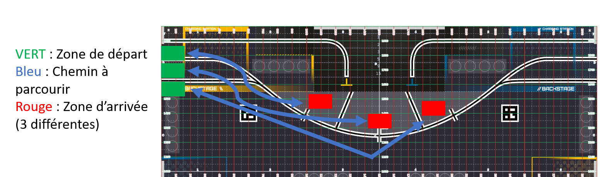 
  <em>Figure 5 : Trajectoire des PAMI groupies (Vert : Zone de départ | Bleu : Chemins | Rouge : Zones d'arrivée)</em>

### 2.5. Architecture des sous-systèmes

* **Motorisation :** Dimensionnement du couple et de la vitesse pour déplacer un robot d'environ $500\text{ g}$ dans un encombrement réduit (longueur moteur $< 4\text{ cm}$ pour en aligner deux dans les $11\text{ cm}$ de largeur). Deux PAMI sont équipés de moteurs rapides (chemins longs) et le troisième de moteurs plus lents (chemin court).
* **Alimentation :** Batterie USB délivrant un $5\text{ V}$ régulé capable d'alimenter les moteurs CC, encodeurs, capteurs ultrasons, capteur ToF et servomoteur pendant plusieurs matchs sans nécessiter de sac ignifugé LiPo.
* **Modélisation 3D :** Conception intégrale sous Fusion 360 pour garantir le respect du gabarit ($11 \times 15\text{ cm}$) et la répartition des masses.
* **Circuit Imprimé (PCB) :** Conception sous KiCad regroupant l'ESP32, le driver moteur et les connecteurs capteurs/actionneurs avec plans de masse et LEDs de diagnostic.
* **Évitement d'obstacles :** Fusion d'un capteur ToF matriciel central (mesure de distance sur une grille multi-zones) et de deux capteurs à ultrasons latéraux pour supprimer les angles morts.

---

## 🛠️ 3. Conception et Réalisation Technique

### 3.1. Conception et modélisation 3D des PAMI

La modélisation 3D a été créée afin d'intégrer tous les composants dans les contraintes de taille et de poids du règlement, tout en répartissant le poids équitablement et en assurant une solidité générale élevée.

Une première modélisation regroupant les principaux éléments a permis de valider l'architecture :

  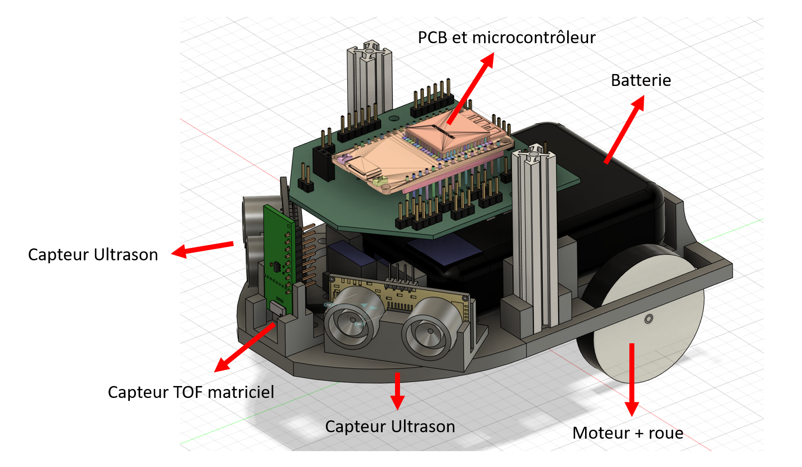 
  <em>Figure 11 : Modélisation préliminaire d'un PAMI</em>

On observe que les capteurs utilisés dans l'évitement sont placés avec un angle précis, ce qui leur permet de couvrir une surface maximale et au robot de ne pas avoir d'angle mort à l'avant. Cette modélisation a servi à imprimer un premier prototype pour les tests de motorisation et d'asservissement :

  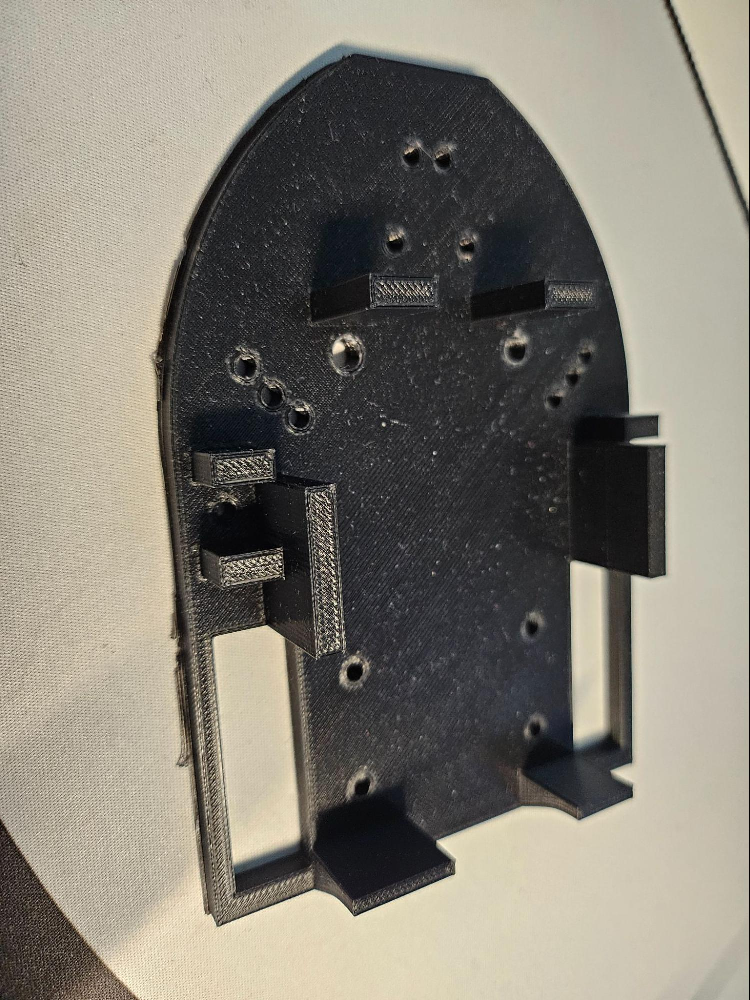 
  <em>Figure 12 : Impression de la structure principale</em>

Les pièces permettant d'attacher les principaux composants ont également été modélisées puis imprimées :

  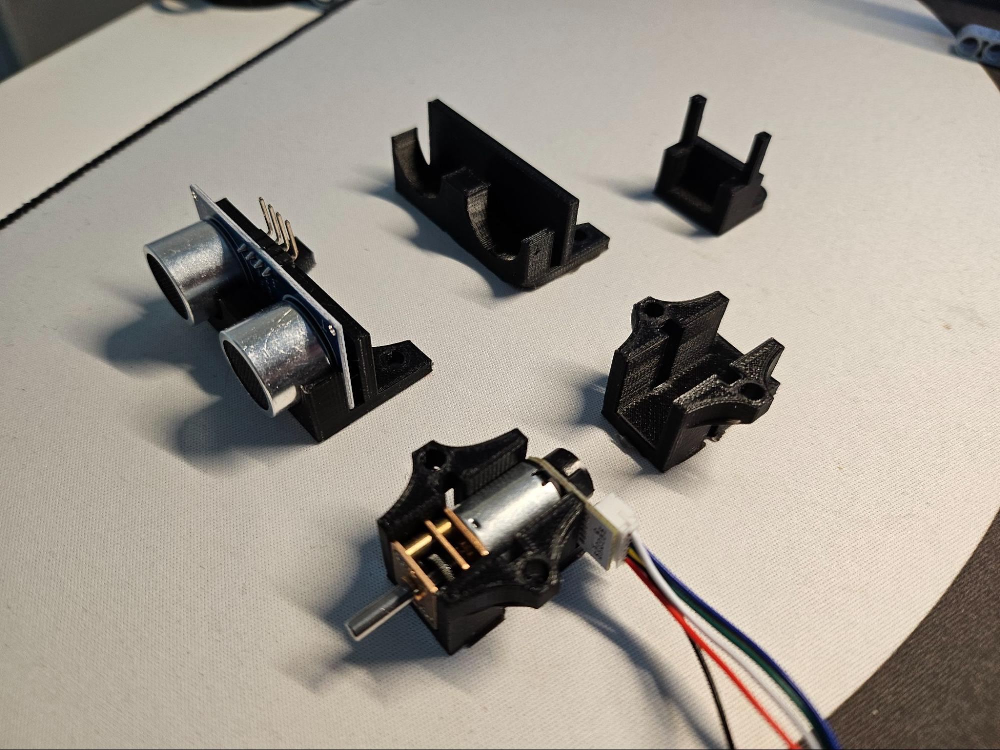 
  <em>Figure 13 : Impression des différentes attaches</em>

Les tests effectués sur ce premier prototype étant satisfaisants, cette base a été retenue. En raison du thème "Viking" choisi par l'association Polybot, la modélisation a ensuite évolué vers la version finale, qui s'inspire d'un drakkar viking stylisé :

  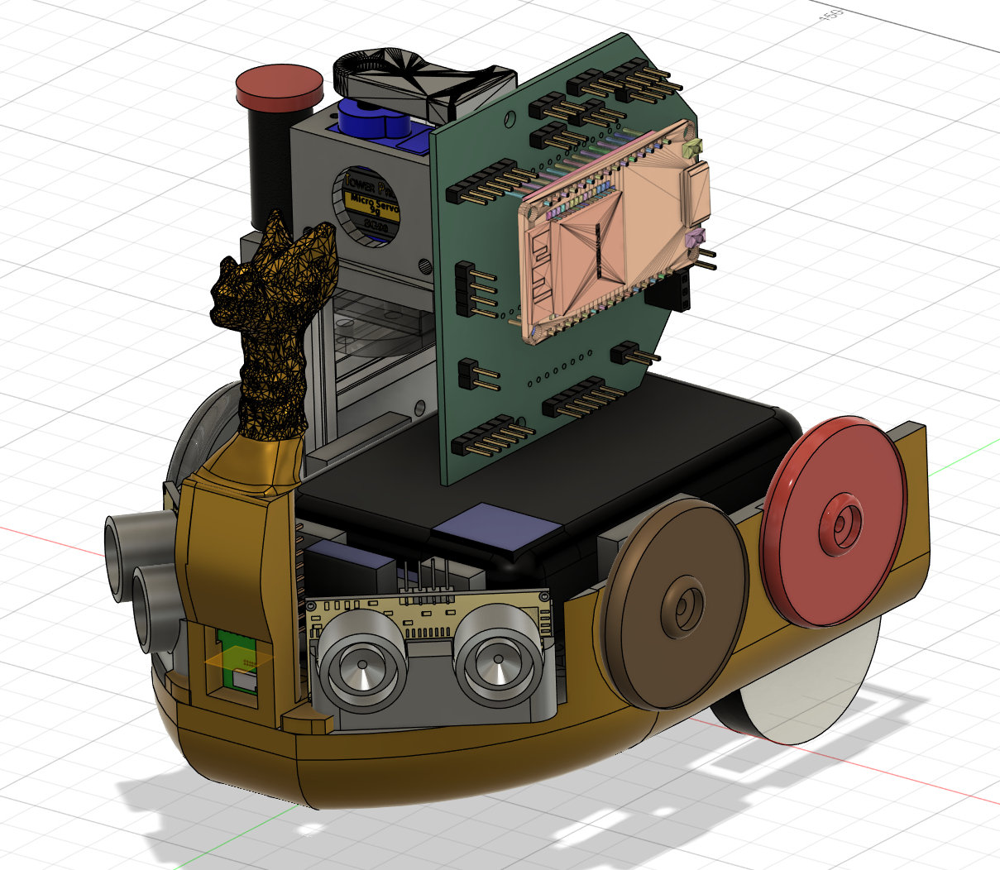 
  <em>Figure 14 : Modélisation finale du PAMI</em>

Les éléments esthétiques (proue, coque texturée, boucliers latéraux) ont été intégrés sans compromettre la modularité du PAMI grâce à l'utilisation de fixations standardisées (vis M3) et de supports dédiés. Le PCB a également été intégré au design de l'actionneur de fin de match en représentant la voile du Drakkar.

L'angle de vision des capteurs d'évitement d'obstacles est représenté par des cônes : l'angle total théorique couvre parfaitement la face avant du PAMI, avec des dimensions finales de $11\text{ cm}$ par $14,5\text{ cm}$ conformes au cahier des charges.

  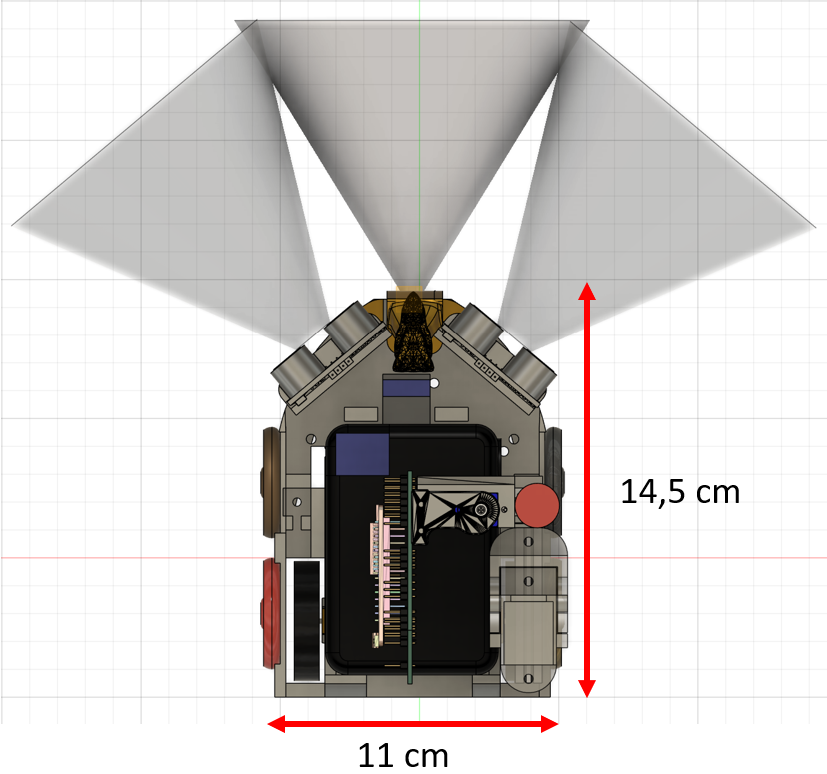 
  <em>Figure 15 : Angle de vision et dimensions</em>

Cette modélisation a ensuite été imprimée puis peinte afin de correspondre au thème Viking :

  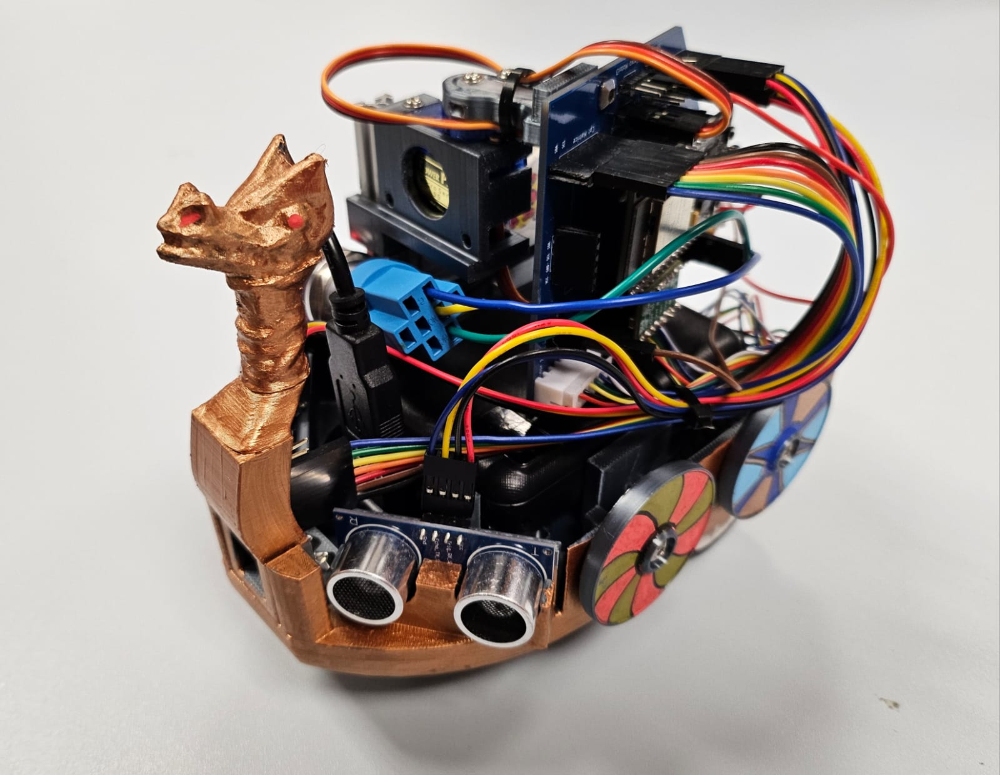 
  <em>Figure 16 : Image Réelle du PAMI</em>

---

### 3.2. Le PCB (Printed Circuit Board)

Le PCB du PAMI centralise les connexions entre le microcontrôleur, les capteurs, les moteurs et les actionneurs afin d'optimiser l'architecture interne, réduire l'encombrement et fiabiliser les connexions. Conçu sur **KiCad**, son développement a suivi quatre étapes :

1. Réalisation du schéma électronique
2. Tests du circuit sur protoboard
3. Conception et fabrication du PCB
4. Réception et validation du PCB

#### 3.2.1. Réalisation du schéma électronique sur KiCad

La première étape consiste à modéliser le schéma électronique dans l'éditeur de schématique de KiCad en associant les empreintes (*footprints*) de chaque composant (créées manuellement ou importées via SnapEDA). Une vérification est ensuite réalisée à l'aide de l'outil ERC (*Electrical Rules Check*) intégré à KiCad afin de détecter d'éventuelles erreurs de connexions ou conflits de signaux.

  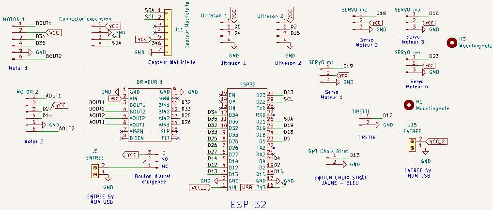 
  <em>Figure 17 : Schéma électronique du circuit</em>

#### 3.2.2. Test du circuit sur protoboard

Avant la fabrication du PCB, le circuit a été validé sur protoboard. Les tests ont été réalisés progressivement en intégrant les composants un à un pour vérifier l'absence de courts-circuits et le bon fonctionnement des signaux électriques et des alimentations.

#### 3.2.3. Conception et fabrication du PCB

L'édition du PCB sur KiCad comprend le **placement des composants** en tenant compte des contraintes d'encombrement, le **routage des pistes** en respectant les règles de conception électronique (largeur des pistes, distances minimales, plans de masse) et la **vérification des contraintes électriques** (DRC - *Design Rules Check*).

  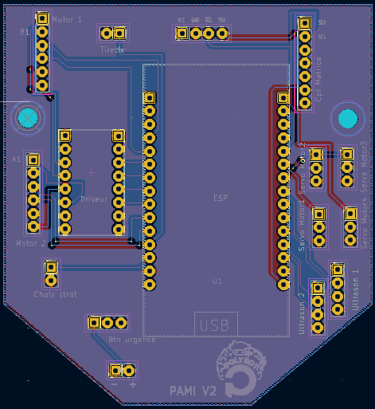
  &nbsp;&nbsp;
  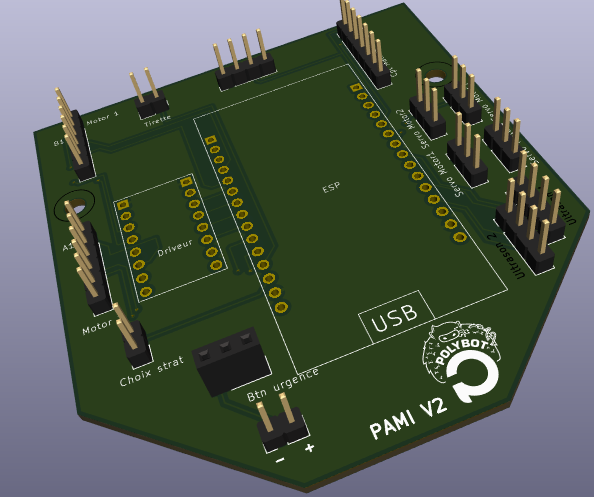 
  <em>Figure 18 : Routage 2D et visualisation du PCB en 3D</em>

Une fois ces étapes validées, les fichiers de fabrication (Gerber) ont été générés et envoyés chez JLCPCB.

#### 3.2.4. Réception et validation du PCB

À la réception du PCB, la continuité des pistes et l'absence de courts-circuits ont été contrôlées au multimètre avant de souder les composants et de réaliser le test fonctionnel final.

---

### 3.3. L'asservissement en vitesse

Pour que le PAMI ait un déplacement fluide et précis, un asservissement en vitesse a d'abord été mis en place afin de maîtriser les éléments de la chaîne de commande : pilotage des moteurs (PWM de 0 à 255), lecture des encodeurs et conversion en vitesse réelle ($\text{tr/s}$).

  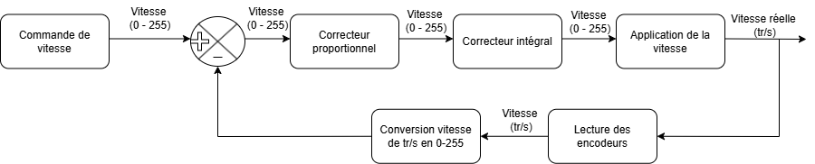 
  <em>Figure 19 : Schéma d'asservissement en vitesse</em>

Cet asservissement permet de vérifier que le comportement du robot est cohérent, que le courant fourni par l'alimentation est suffisant et que la mécanique globale est saine (absence de glissement des roues, couple suffisant).

Le résultat de cet asservissement pour une consigne de vitesse de $0,22\text{ tr/s}$ avec une période d'échantillonnage de $100\text{ ms}$ donne la courbe suivante (Figure 20) :

  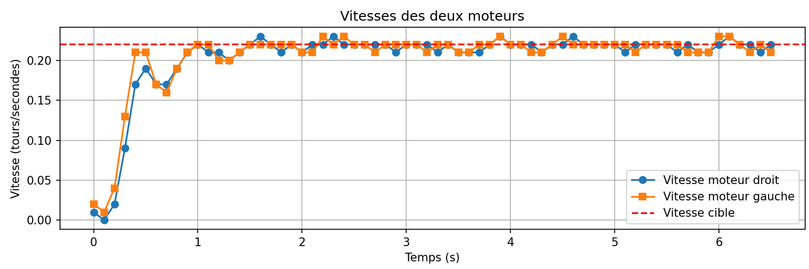 
  <em>Figure 20 : Vitesse en fonction du temps, vitesse cible = $0,22\text{ tr/s}$</em>

On effectue également le test à une vitesse plus élevée de $0,88\text{ tr/s}$, plus représentative du comportement du robot en match (Figure 21) :

  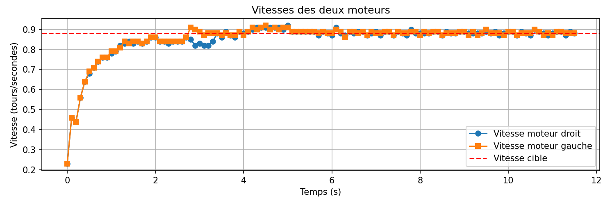 
  <em>Figure 21 : Vitesse en fonction du temps, vitesse cible = $0,88\text{ tr/s}$</em>

En traçant la commande de vitesse (Figure 22), on remarque que les deux commandes des moteurs gauche et droit sont différentes afin de compenser les défauts intrinsèques des moteurs (frottements) ou un centre de gravité légèrement décentré.

  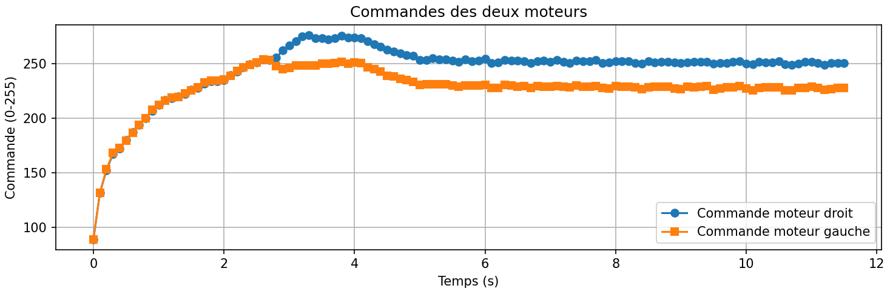 
  <em>Figure 22 : Commande en fonction du temps, vitesse cible = $0,88\text{ tr/s}$</em>

On teste ensuite la capacité de l'asservissement à compenser une perturbation en bloquant temporairement le moteur gauche (Figure 23) :

  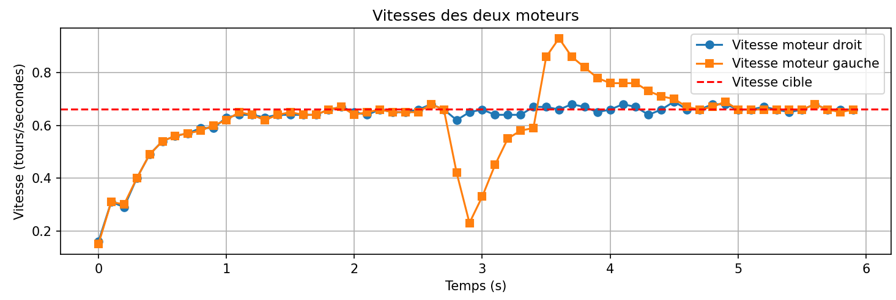 
  <em>Figure 23 : Vitesse en fonction du temps, vitesse cible = $0,66\text{ tr/s}$, perturbation</em>

On trace également le calcul de la position du robot à partir de la vitesse des roues. Le delta de vitesse entre les deux roues permet de calculer l'angle instantané du robot, utilisé par trigonométrie pour retrouver le déplacement en $X$ et en $Y$ (Figure 24) :

  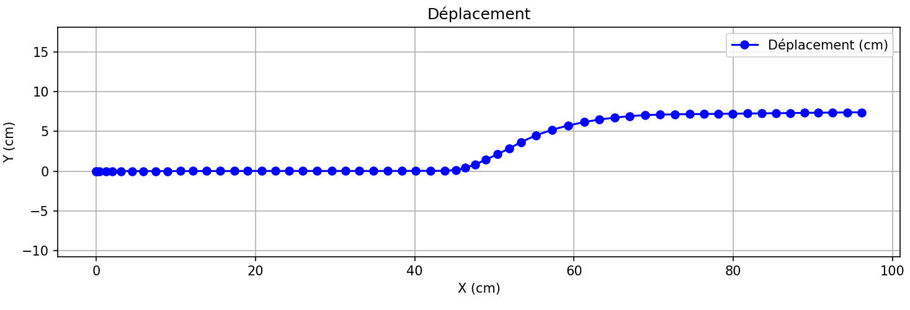 
  <em>Figure 24 : Déplacement en fonction du temps, vitesse cible = $0,66\text{ tr/s}$, perturbation</em>

L'asservissement permet bien de repositionner le robot à un angle nul après la perturbation.

---

### 3.4. L'asservissement en position

Un asservissement en position a ensuite été développé pour permettre au PAMI d'évoluer dans un système de coordonnées lié au terrain ($200\text{ cm} \times 300\text{ cm}$, avec une résolution de $1\text{ cm} \times 1\text{ cm}$). Le robot reçoit ainsi des coordonnées cibles $(X, Y)$ et mesure son déplacement en temps réel par odométrie.

  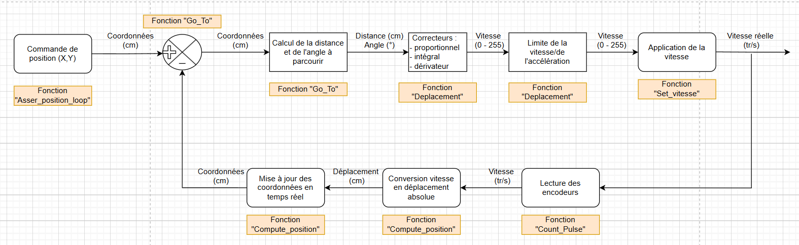 
  <em>Figure 25 : Schéma d'asservissement en position</em>

Cet algorithme est exécuté toutes les $100\text{ ms}$ via une interruption matérielle. Les coefficients du correcteur PID ainsi que l'accélération maximale ont été déterminés de manière empirique :
* $K_p$ (proportionnel) : ajusté pour améliorer la réactivité sans provoquer de dépassement excessif.
* $K_i$ (intégral) : modifié pour corriger les erreurs statiques résiduelles sans introduire d'oscillations.
* $K_d$ (dérivé) : augmenté pour amortir les variations brusques.

On trace le déplacement du robot dans le pire cas possible (PAMI avec les moteurs les plus lents) sur un chemin passant par 3 points successifs stockés dans un tableau : $(30;15)$, $(70;70)$ et $(100;70)$, afin de contourner l'estrade située devant la zone de départ (Figure 26).

  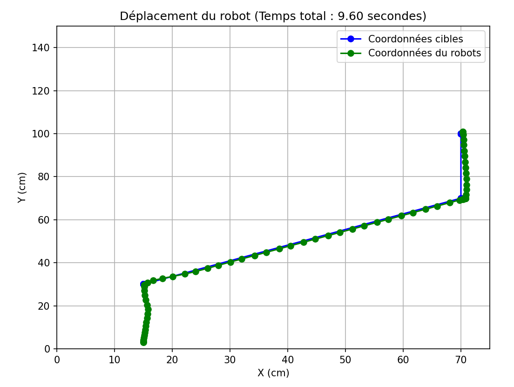 
  <em>Figure 26 : Déplacement du robot, chemin 1 (sans obstacles/perturbations)</em>

La consigne de coordonnées est bien respectée. Le Tableau 4 compare les erreurs obtenues par l'odométrie interne du robot et les erreurs mesurées réellement sur le terrain :

| Type d'erreur | Axe $X\text{ (cm)}$ | Axe $Y\text{ (cm)}$ |
| :--- | :---: | :---: |
| **Erreur de l'odométrie du robot** | $$\frac{70,35 - 70}{70} \times 100 = 0,5\%$$ | $$\frac{100,92 - 100}{100} \times 100 = 0,92\%$$ |
| **Erreur mesurée sur le terrain** | $$\frac{71 - 70}{70} \times 100 = 1,42\%$$ | $$\frac{105 - 100}{100} \times 100 = 5\%$$ |

*Tableau 4 : Erreurs relatives du déplacement, chemin 1 (sans obstacles)*

L'écart entre la théorie et le terrain provient principalement du léger glissement des roues lors des rotations. Ces erreurs restent tout à fait tolérables car la zone d'arrivée mesure environ $30\text{ cm}$ de large.

On teste également la réponse de l'asservissement en position face à une perturbation (blocage temporaire de la roue gauche sur le même parcours, Figure 27) :

  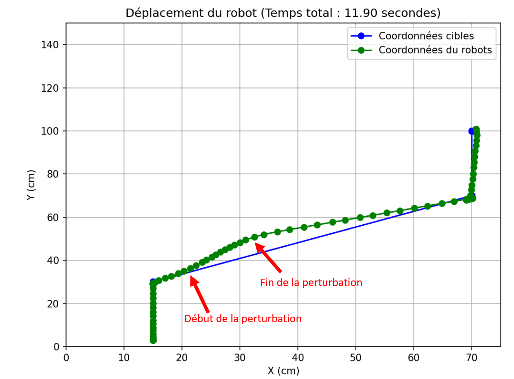 
  <em>Figure 27 : Déplacement du robot, chemin 1 avec perturbation</em>

L'asservissement compense efficacement la perturbation pour rejoindre ses coordonnées cibles (erreur d'odométrie $< 1\%$), au prix d'un temps de parcours légèrement supérieur ($11,90\text{ s}$ contre $9,60\text{ s}$).

L'évolution des vitesses des moteurs droit et gauche sur le parcours nominal (Figure 28) montre un temps de réponse satisfaisant. Les courtes pauses visibles entre chaque segment correspondent aux vérifications de l'algorithme d'évitement d'obstacles.

  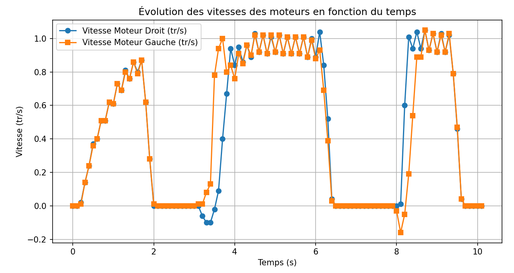 
  <em>Figure 28 : Vitesse du robot, chemin 1 (sans obstacles/perturbations)</em>

---

### 3.5. La détection d'obstacles

La détection d'obstacles repose sur la combinaison de deux capteurs à ultrasons `HC-SR04` (ou `HC-2304-C`) et d'un capteur matriciel Time-of-Flight `VL53L5CX`.

  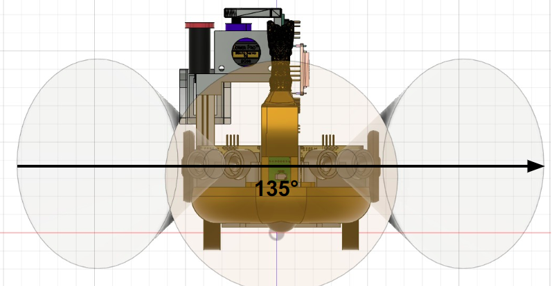 
  <em>Figure 29 : Angle de vision du PAMI ($135^{\circ}$)</em>

#### Matériel et positionnement

Les deux capteurs à ultrasons sont placés de chaque côté du robot et servent de capteurs secondaires (surveillance périphérique et arrêt d'urgence). Le capteur ToF matriciel est situé au centre pour offrir une visualisation spatiale précise des obstacles situés devant le robot.

  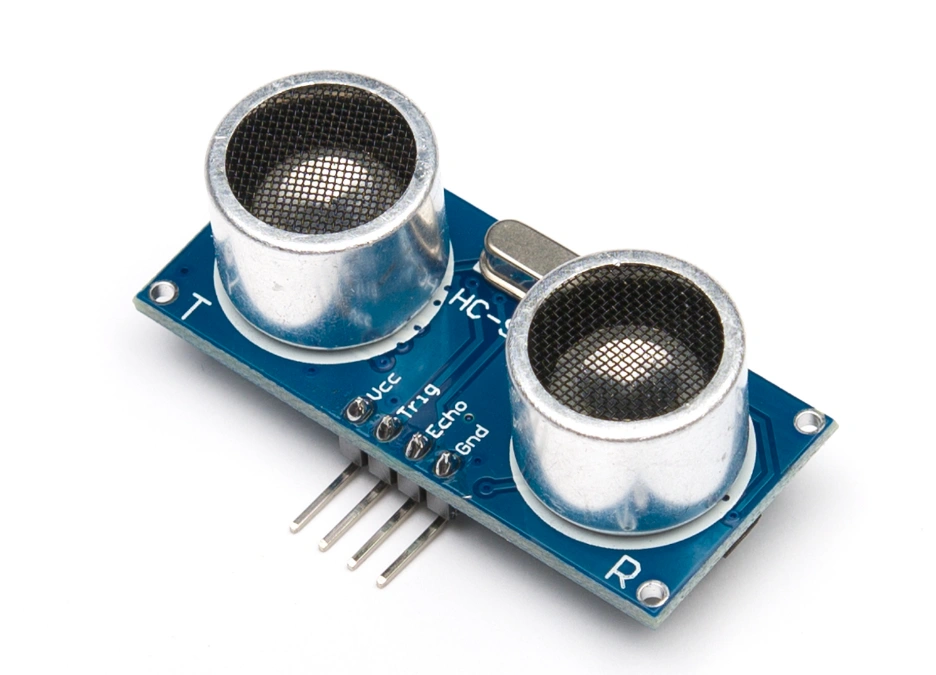
  &nbsp;&nbsp;&nbsp;&nbsp;
  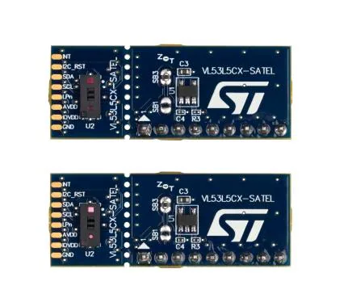 
  <em>Figure 30 : Capteur Ultrason HC-SR04 &nbsp;&nbsp;|&nbsp;&nbsp; Figure 31 : Capteur matriciel Time-of-Flight VL53L5CX</em>

#### Concepts mathématiques et champ de vision

* **Capteurs à ultrasons :** Chaque capteur possède un angle d'ouverture d'environ **$45^{\circ}$**, soit une couverture combinée de **$90^{\circ}$**.
* **Capteur ToF (Time-of-Flight) :** Émet des faisceaux infrarouges étroits et précis répartis en une matrice de **16 zones ($4 \times 4$)** avec un espacement angulaire d'environ $15^{\circ}$ entre les rayons. Comme l'objectif n'est pas de mesurer la hauteur des objets, seules les **rangées 4 à 7** (plan horizontal médian) sont exploitées afin d'éviter toute détection parasite du sol.
* **Couverture globale :** La combinaison des deux technologies offre un champ de vision horizontal total de **$135^{\circ}$**.

  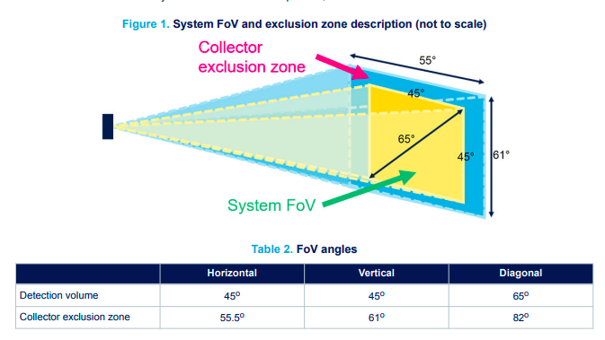
  &nbsp;&nbsp;
  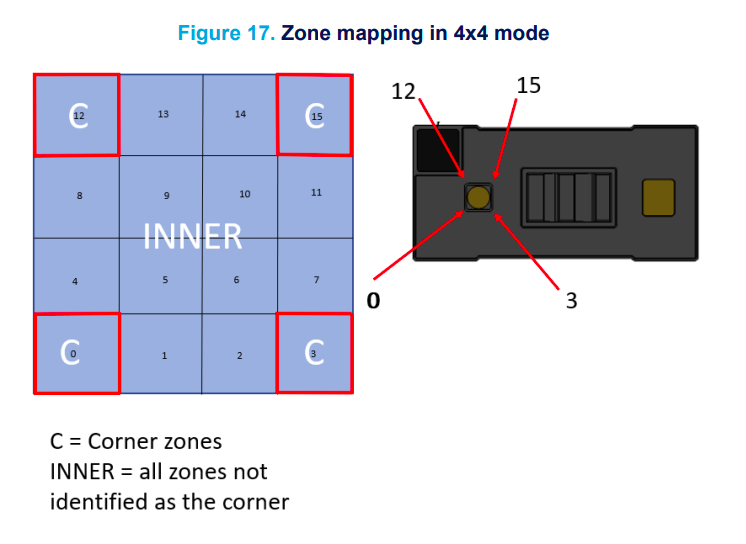 
  <em>Figure 32 : Angles FoV (Datasheet VL53L5CX) &nbsp;&nbsp;|&nbsp;&nbsp; Figure 33 : Mapping des zones en mode 4x4 (Datasheet VL53L5CX)</em>

#### Architecture électronique des capteurs

Tous les capteurs sont alimentés en **$5\text{ V}$**, à l'exception du capteur ToF matriciel `VL53L5CX` qui utilise également le **$3,3\text{ V}$**. Les capteurs à ultrasons `HC-SR04` communiquent avec l'ESP32 via des signaux numériques temporels (Trigger/Echo sur broches GPIO dédiées), tandis que le `VL53L5CX` utilise le bus **I2C**. Séparer les bus de communication permet d'isoler les capteurs et de fiabiliser le débogage.

#### Architecture logicielle de détection (`TOF_2.cpp`)

Nous avons adopté une **programmation orientée objet** autour d'une classe `Terrain`, ce qui permet d'encapsuler la carte des obstacles et de mettre à jour directement l'état du terrain sans multiplier les variables globales.

  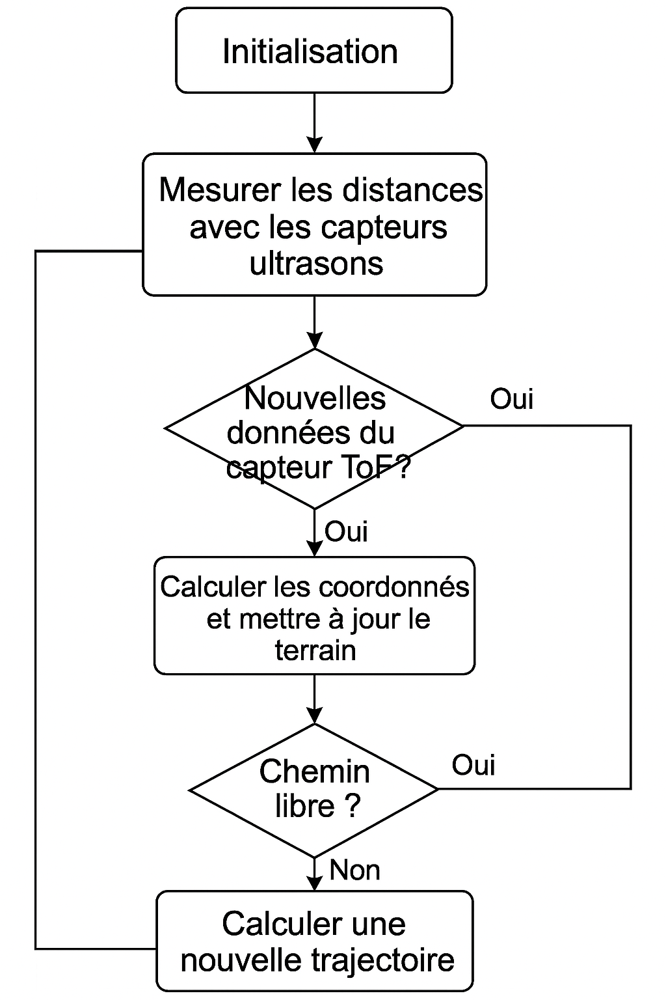 
  <em>Algorigramme général de détection et mise à jour du terrain (TOF 2.cpp)</em>

##### Déroulement de l'algorithme :
1. **Initialisation :** Configuration des broches GPIO (ultrasons), du bus I2C et paramétrage du capteur ToF `VL53L5CX` (fréquence, résolution).
2. **Boucle principale :**
   * **Acquisition des distances :** Lecture périodique des ultrasons et conversion des mesures du ToF en coordonnées $(X, Y)$ sur la table.
   * **Mise à jour de la carte des obstacles :** Intégration des nouveaux points détectés, liaison des points proches et suppression des doublons.
   * **Analyse du chemin :** Vérification de la présence d'un obstacle sur le couloir reliant la position actuelle du robot à sa cible.
   * **Recalcul de la trajectoire :** Si un obstacle coupe la trajectoire, une nouvelle cible intermédiaire est calculée.
3. **Exécution continue :** Répétition du cycle en temps réel tout au long du match.

##### Synthèse des fonctions principales :
* **Initialisation et boucle :**
  * `Tof_setup_spark()` : Configure la communication I2C pour le capteur ToF matriciel et initialise les capteurs ultrasons via les broches GPIO.
  * `Tof_loop_spark()` : Fonction principale appelée dans le `main` qui orchestre la lecture des capteurs et la mise à jour de l'objet `Terrain`.
* **Mesures et cartographie (Classe `Terrain`) :**
  * `MesureUltrasons` : Calcule la distance mesurée par les capteurs à ultrasons à partir de la durée d'impulsion.
  * `markLine` : Trace un segment entre deux points $(x_1, y_1)$ et $(x_2, y_2)$ dans la liste des coordonnées occupées pour modéliser un obstacle continu.
  * `isWithinDistance` : Vérifie si deux points détectés par le ToF sont suffisamment proches pour appartenir au même obstacle et être reliés.
  * `removeDuplicate` : Supprime les coordonnées redondantes en mémoire pour optimiser le stockage et les temps de calcul.
* **Analyse du terrain :**
  * `estCheminLibre` : Vérifie par pas successifs (en tenant compte de la largeur du PAMI) si le couloir entre le robot et sa cible est dégagé (Figure 34).
  * `estLibre` : Teste si une coordonnée spécifique $(x, y)$ appartient à la liste des obstacles.
* **Gestion des zones fixes :**
  * `jaune` et `bleu` : Initialise la carte avec les coordonnées connues de l'estrade selon la couleur d'équipe.

  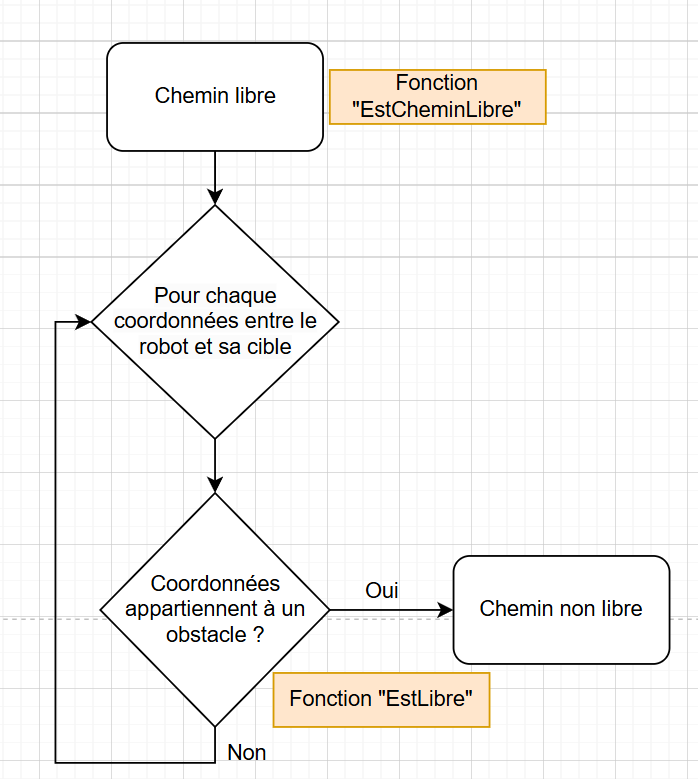 
  <em>Figure 34 : Algorigramme de la fonction "estCheminLibre"</em>

La Figure 35 illustre la carte interne générée par le PAMI : l'estrade prédéfinie ainsi qu'un obstacle ajouté devant la zone de départ sont correctement positionnés dans le repère de la table.

  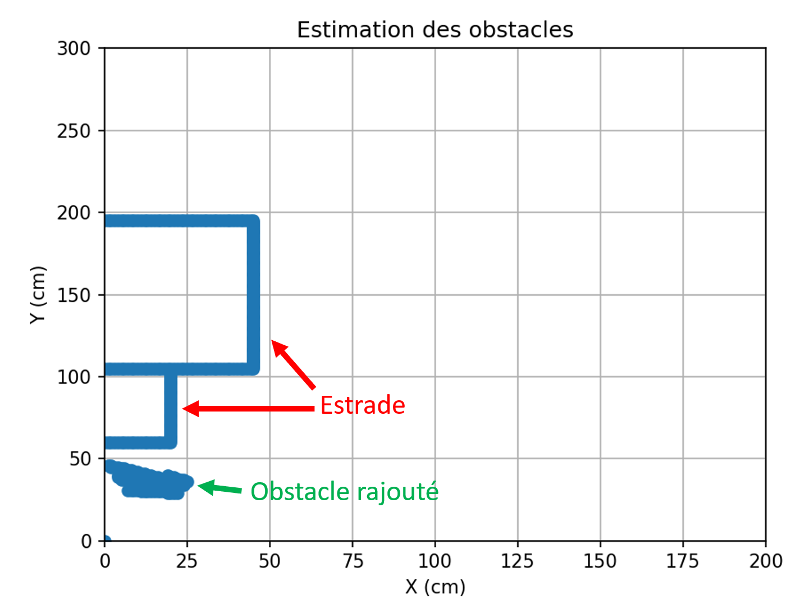 
  <em>Figure 35 : Visualisation des obstacles par le PAMI</em>

*Note technique :* Afin d'éviter qu'un PAMI ne détecte les autres PAMI de notre propre équipe au démarrage ou n'enregistre des obstacles trop lointains, un départ différé de 2 secondes entre chaque robot est appliqué et seules les mesures ToF inférieures à $30\text{ cm}$ sont ajoutées à la carte.

---

### 3.6. L'évitement d'obstacles

En complément de la cartographie, l'algorithme d'évitement d'obstacles vérifie toutes les $100\text{ ms}$ (en parallèle de l'asservissement en position) si la cible courante est atteignable en ligne droite. Si le chemin est obstrué, il calcule une nouvelle coordonnée cible de contournement (Figure 36).

  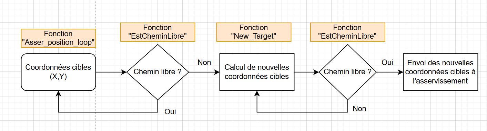 
  <em>Figure 36 : Algorigramme de l'évitement d'obstacle</em>

Le calcul d'une nouvelle coordonnée cible s'effectue par balayage angulaire :
* Calcul de la distance $D$ et de l'angle $\theta$ entre la position actuelle du robot et sa cible bloquée.
* Génération d'une nouvelle cible candidate située à la même distance $D$, mais avec un angle incrémenté de $+1^{\circ}$ ($\theta \leftarrow \theta + 1^{\circ}$).
* Répétition du test `estCheminLibre` jusqu'à trouver une trajectoire dégagée, qui est alors envoyée à l'asservissement en position.

La Figure 37 montre le comportement réel du robot face à un obstacle placé sur son chemin : le point intermédiaire initial $(70;70)$ étant bloqué, le robot génère une nouvelle cible (point rouge) qui lui permet de contourner l'obstacle avant de rejoindre sa destination finale $(70;100)$ en $13,20\text{ s}$.

  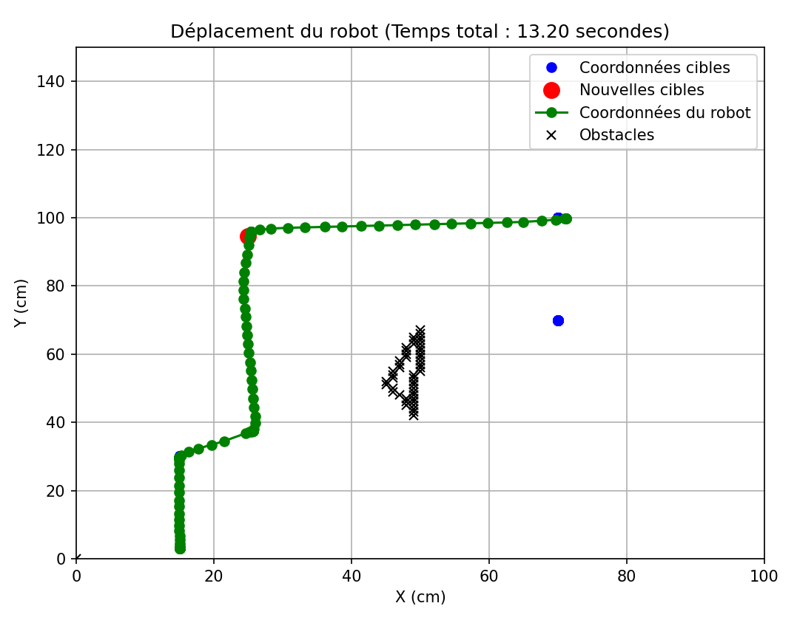 
  <em>Figure 37 : Déplacement du robot, chemin 1 avec contournement d'obstacle</em>

#### Limites de la méthode actuelle

Comme la recherche de cible conserve la distance initiale et incrémente l'angle dans un seul sens, la trajectoire trouvée n'est pas toujours la plus courte (Figure 38) :

  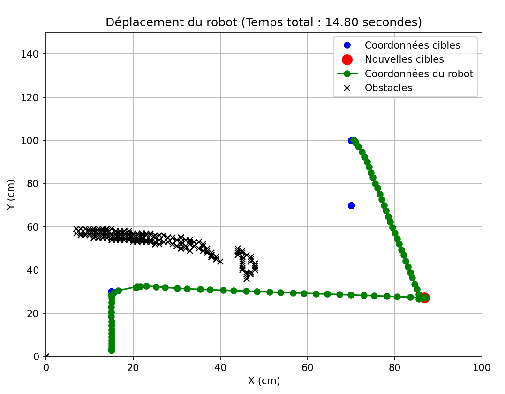 
  <em>Figure 38 : Déplacement du robot avec contournement large ($14,80\text{ s}$)</em>

Dans ce cas défavorable testé sur le PAMI équipé des moteurs les plus lents, le détour porte le temps de parcours à $14,80\text{ s}$ (proche de la limite réglementaire de $15\text{ s}$). Les deux autres PAMI disposent toutefois de moteurs nettement plus rapides qui leur assurent une marge confortable même en cas de contournement large.

---

### 3.7. L'actionneur de fin de match

Conformément au règlement Eurobot / CDFR 2025, les PAMI doivent s'animer après la $100^{\text{e}}$ seconde du match pour créer une ambiance festive et remporter des points supplémentaires.

Nous avons conçu un actionneur piloté par un servomoteur sur lequel est directement fixé le PCB. À la fin du temps réglementaire, le servomoteur oscille pour faire bouger le PCB comme la voile d'un drakkar viking (Figure 39).

  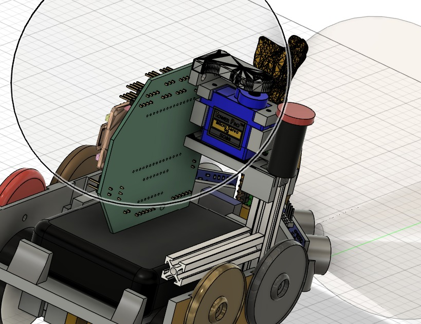 
  <em>Figure 39 : Actionneur de fin de match en visualisation 3D</em>

---

## 📦 4. Livrables et Ressources

L'ensemble des ressources produites dans le cadre de ce projet est regroupé sur les plateformes suivantes :

* **Code source embarqué :** Disponible dans ce dépôt et sur le [GitLab de Polybot Grenoble](https://gitlab.com/polybot-grenoble/2024-2025/pami-2024-groupies.git).
* **Modélisation CAO 3D :** Fichiers disponibles sur l'espace partagé Fusion 360 de l'association Polybot.
* **Documentation technique et fichiers PCB :** Schémas KiCad, empreintes et documentation de passation sur le [Google Drive Polybot](https://drive.google.com/drive/folders/1Busn3JRkrjzDavwfdd-4tdXkihkWdWTS?usp=drive_link).
* **Robots assemblés :** Les 3 PAMI Groupies finalisés et prêts pour la compétition (Figure 40).

   
  <em>Figure 40 : Les 3 PAMI Groupies assemblés</em>

---

## 🚀 5. Perspectives d'amélioration et Conclusion

### 5.1. Pistes d'amélioration

Pour les prochaines itérations du projet, plusieurs évolutions techniques sont envisagées :
* **Révision du PCB :** Intégration de capacités de découplage supplémentaires au plus près des composants pour lisser davantage les appels de courant des moteurs et renforcer la stabilité de l'alimentation.
* **Ajout d'une IHM embarquée :** Intégration d'un petit écran OLED ou de retours visuels étendus pour afficher en temps réel les diagnostics des capteurs, le choix de l'équipe (Jaune/Bleu) et l'état de la stratégie sans nécessiter de liaison série.
* **Optimisation de l'évitement d'obstacles :** Amélioration de l'algorithme de recherche de cible (balayage angulaire bidirectionnel $\pm \theta$ et effacement dynamique des obstacles mobiles disparus) afin de minimiser la distance de contournement.

### 5.2. Conclusion

Ce projet technique a permis de concevoir, fabriquer et valider une nouvelle génération de PAMI fiables et autonomes pour la Coupe de France de Robotique 2025. Le passage à des moteurs avec encodeurs, la conception d'un PCB dédié, l'implémentation d'un asservissement en position par odométrie et l'intégration d'un capteur ToF matriciel répondent pleinement aux problématiques rencontrées lors des éditions précédentes. L'architecture matérielle et logicielle documentée dans ce dépôt constitue une base solide et directement réutilisable pour les futures équipes de l'association Polybot.

---

## 📚 Glossaire

* **CDFR :** Coupe de France de Robotique.
* **I2C :** *Inter-Integrated Circuit*, protocole de communication série synchrone.
* **PAMI :** Petit Actionneur Mobile Indépendant (robot autonome annexe).
* **PCB (*Printed Circuit Board*) :** Circuit imprimé.
* **ToF (*Time-of-Flight*) :** Capteur mesurant la distance par calcul du temps de vol d'une impulsion lumineuse (infrarouge).
* **Asservissement :** Technique de commande permettant de corriger un système en fonction de l'écart entre une valeur mesurée et une valeur de consigne.
* **PID (Proportionnel-Intégral-Dérivé) :** Algorithme de régulation utilisé en asservissement pour minimiser l'erreur entre la sortie d'un système et la consigne.
* **Odométrie :** Méthode permettant d'estimer la position $(X, Y)$ et l'orientation $\theta$ d'un robot en fonction des déplacements mesurés par les encodeurs de ses roues.
* **Encodeur :** Capteur mesurant la rotation d'un axe et permettant de déterminer la vitesse et la position angulaire d'un moteur.